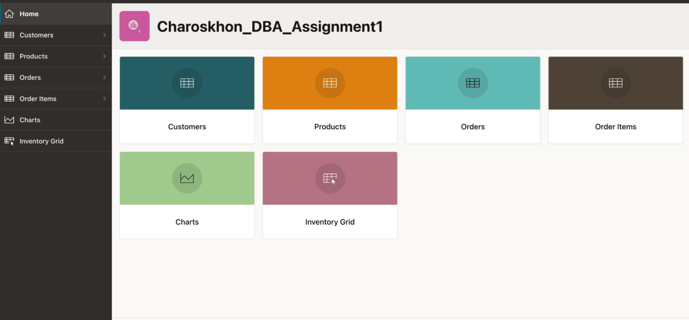
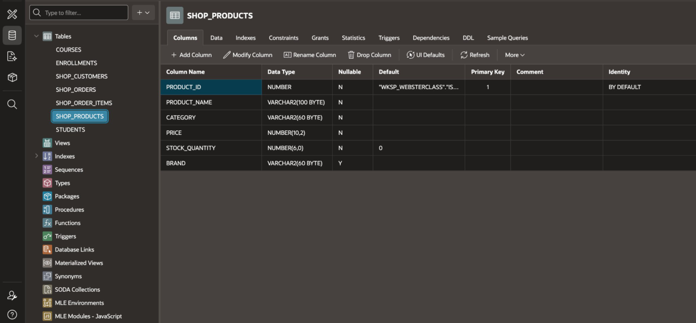
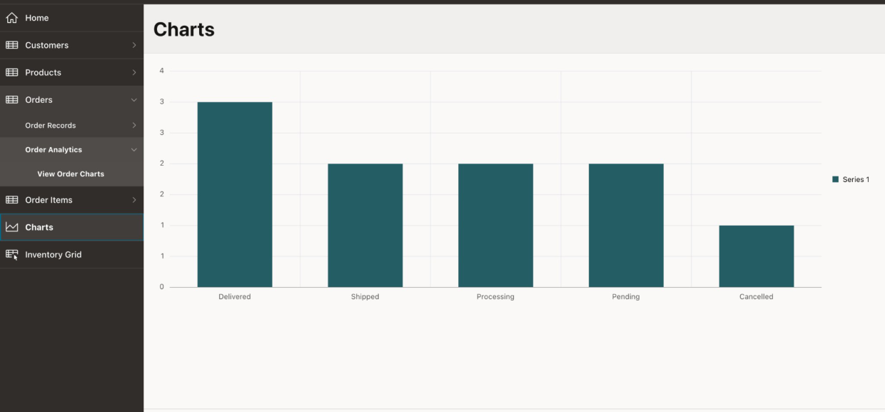
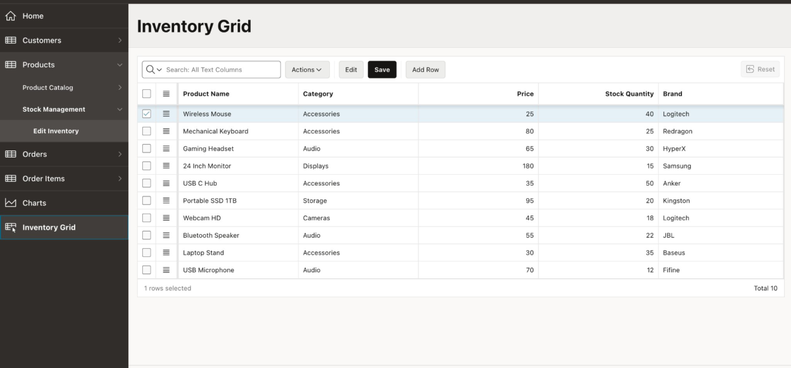

# Oracle APEX Shopping Management Application

**Academic project | Webster University in Tashkent | Database Applications | September 2026**

**Author:** Charoskhon Farkhadova  
**Platform:** Oracle APEX, Oracle Database  
**Project type:** Low-code web application / database application

## Project overview

This academic Oracle APEX application provides a web interface for managing four related business entities in a sample online shopping workflow: customers, products, orders, and order items. The work documents database tables, interactive reports, a three-level navigation menu, a chart, an editable inventory grid, and customer create/edit forms.

The project was completed as a practical Database Applications assignment at Webster University in Tashkent. **The screenshots below document the implemented application.**

## Features demonstrated

- **Four business tables:** `SHOP_CUSTOMERS`, `SHOP_PRODUCTS`, `SHOP_ORDERS`, and `SHOP_ORDER_ITEMS`.
- **Interactive reports:** customer, product, order, and order-item lists.
- **Navigation hierarchy:** four business sections with submenus and third-level navigation entries; additional top-level shortcuts for charts and inventory.
- **Customer forms:** create a new customer record and update an existing record.
- **Inventory editing:** interactive grid with edit, save, and add-row controls.
- **Order analytics:** bar chart of order status distribution.

## Evidence from the application

| Home dashboard | Product table design |
|---|---|
|  |  |

| Order status chart | Editable inventory grid |
|---|---|
|  |  |

The screenshots were cropped from the original academic evidence report to omit browser account information and institutional session details. No sensitive credentials are included.

## Reported results

- The original four tables contained **10 sample records each**.
- The customer report later displayed **11 records** after a test customer was added.
- The chart summarized **10 orders**: 3 Delivered, 2 Shipped, 2 Processing, 2 Pending, and 1 Cancelled.
- The navigation configuration contained **23 entries**, including application shortcuts.

## Technical details

See [Database and application design](docs/application-design.md) for the table-level structure, reported UI pages, user flows, and feature boundaries.

## Repository scope

This repository contains a **case study and screenshots** of the completed coursework. It **does not yet contain the Oracle APEX application export** or an independently runnable source package. Reproducing the live application requires an Oracle APEX export from the original environment and an appropriate Oracle workspace. The screenshots are not a substitute for an executable export.

All example customer/order records are for demonstration. Do not use institutional accounts, real user records, passwords, private workspace URLs, or session details in a public repository.

## Skills demonstrated

Oracle APEX · Relational Database Design · Database Applications · Interactive Reports · Web Forms · Low-Code Development · Business Data Management · Data Visualization · UI Navigation

---

[GitHub profile](https://github.com/requiembby) · [LinkedIn](https://www.linkedin.com/in/charoskhon-farkhadova-2148a9307/)